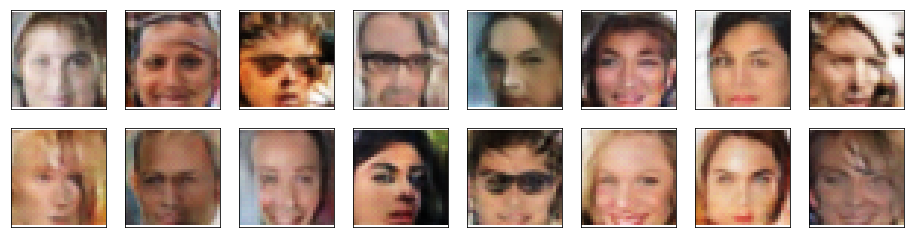
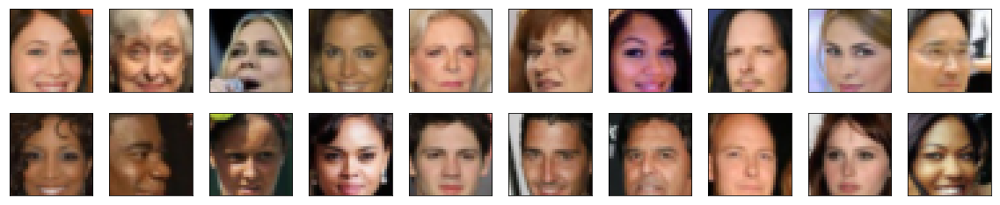
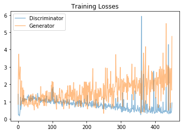

# Face generation with a DCGAN


Can a network learn to draw faces that don't exist, just by playing a game against another network? This is a deep convolutional GAN (DCGAN) trained on celebrity photos, built in PyTorch.

This was a project in Udacity's Deep Learning Nanodegree. The course gave the notebook structure, the data and the unit tests in `problem_unittests.py`. I wrote the data loading, both networks, the losses and the training loop.

## These faces aren't real



*16 faces from the generator after 30 epochs, at 32×32 pixels.*

## How it works

A GAN has two networks pulling against each other:

- **The generator** takes 100 random numbers and turns them into a 32×32 colour image.
- **The discriminator** looks at an image and guesses whether it's a real photo or one the generator made.

The discriminator learns to spot fakes, and the generator learns from its mistakes. If training goes well, the generator ends up making images the discriminator can't tell apart from real ones.

| | Generator | Discriminator |
|---|---|---|
| Input | 100 random numbers, uniform on [-1, 1] | 32×32×3 image, scaled to [-1, 1] |
| Layers | A linear layer to 4×4×128, then 3 transposed convolutions up to 32×32×3 | 3 strided convolutions down to 4×4×128, then a linear layer |
| Activations | ReLU, and tanh on the output | Leaky ReLU (slope 0.2) |
| Normalisation | Batch norm on every layer except the last | Batch norm on every layer except the first |

Following the [DCGAN paper](https://arxiv.org/pdf/1511.06434.pdf), there's no pooling. The networks resize with strides instead, and all weights start from a normal distribution with standard deviation 0.02.

**Training:** binary cross-entropy loss, Adam for both networks (learning rate 0.0002, β₁ 0.5, β₂ 0.999), batch size 128, 30 epochs on a GPU.

## The data

A cropped subset of [CelebA](http://mmlab.ie.cuhk.edu.hk/projects/CelebA.html), supplied by the course, resized to 32×32. Here's what the real photos look like:



## Training



GAN losses don't fall the way a normal model's loss does, because each network's loss depends on how good the other one is. Here the discriminator's loss drifts down to around 0.5 and the generator's drifts up, with bigger spikes towards the end. That means the discriminator was slowly winning. Training longer probably wouldn't help much without changes such as label smoothing or a stronger generator.

## Caveats

- **There's no score.** I judged the faces by eye. A measure like FID (Fréchet Inception Distance) would let me compare runs properly.
- **The dataset is biased.** CelebA is mostly young, white celebrities, and the generated faces reflect that. A model trained on it shouldn't be taken as a picture of what faces look like in general.
- **32×32 is tiny.** The faces are blurry, and the backgrounds and edges often smear.
- **One run.** The samples come from one training run and one fixed set of random inputs.
- **The course template shapes a lot of this.** The cells marked "DON'T MODIFY" are Udacity's code.

## How to run

You need a GPU. Training on a CPU takes hours.

```bash
pip install torch torchvision numpy matplotlib jupyter
jupyter notebook dlnd_face_generation.ipynb
```

The dataset isn't included in this repo. Download `processed_celeba_small.zip` from the course materials, or build your own folder of cropped CelebA images, and put it next to the notebook. The first cell unzips it.

## What I'd like to do next

Add FID so I can compare changes properly, try label smoothing (the `smooth` option is already in `real_loss`, but I never switched it on), and move up to 64×64 images.
